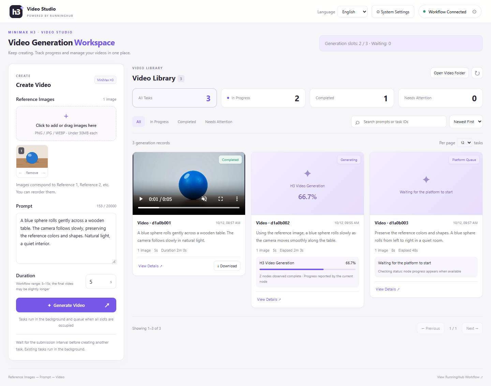
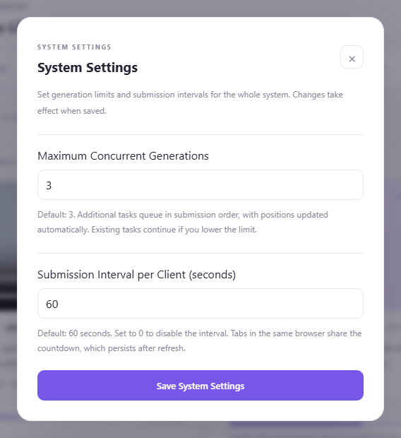

# H3 Video Studio

**English** | [简体中文](README.zh-CN.md)

Turn reference images and ideas into videos, with creation and management in one place.

H3 Video Studio is a local workspace for generating MiniMax H3 videos through RunningHub. Add reference images, describe your scene, choose a duration, and submit a generation task. Follow its progress, then play and download the finished video—all from your browser. Designed primarily for desktop use.



## What you can do

- **Create with multiple images**: Select or drag in reference images, arrange their order, and describe subjects, actions, camera movement, and sound in your prompt.
- **Keep creating**: Tasks run in the background and enter a queue when all generation slots are occupied. Closing the browser does not stop them while the local service remains running.
- **Follow progress**: See whether a task is queued, generating, or saving. Progress percentages appear when the workflow reports them.
- **Manage your videos**: Play and download results, filter by status, search your history, or open the local video folder.
- **Set your pace**: Adjust the number of simultaneous generations and the interval between submissions.
- **Choose your language**: Switch between English and Simplified Chinese using the language selector in the upper-right corner. English is the default; your choice is remembered in your browser.

## Interface preview

The workspace above brings video creation, progress tracking, and results together. Open System Settings in the upper-right corner to adjust generation limits and submission intervals.



Screenshots show the English interface with demo tasks.

## Get started

You need Windows, Python 3.11 or later, and your own RunningHub API key.

1. Download the project, open PowerShell in the project directory, and run:

   ```powershell
   .\start.ps1
   ```

2. On the first run, the script prepares the environment and creates `.env`. Press Ctrl+C to stop the service, set `RUNNINGHUB_API_KEY` in `.env`, and run the startup script again.
3. Open [Video Studio](http://127.0.0.1:8765) in your browser. Click Workflow Setup in the upper-right corner, load the workflow, and confirm the settings for images, the prompt, and duration.
4. Add reference images, enter a prompt and duration, then click Generate Video. Track the task on the right and play or download the result when it is ready.

The default [RunningHub H3 workflow](https://www.runninghub.cn/workflow/2108942308824670209) supports 1–9 reference images. Image and duration limits depend on the workflow configuration. Generation runs through your RunningHub account and is billed according to the platform's pricing.

## Where your files go

Reference images and generated videos stay on your computer, in the project's `data` directory by default. Click Open Video Folder to find your results for organizing or backup.

## More information

For custom workflows, detailed configuration, and development instructions, see the [technical and configuration guide (Chinese)](docs/technical-guide.md).
