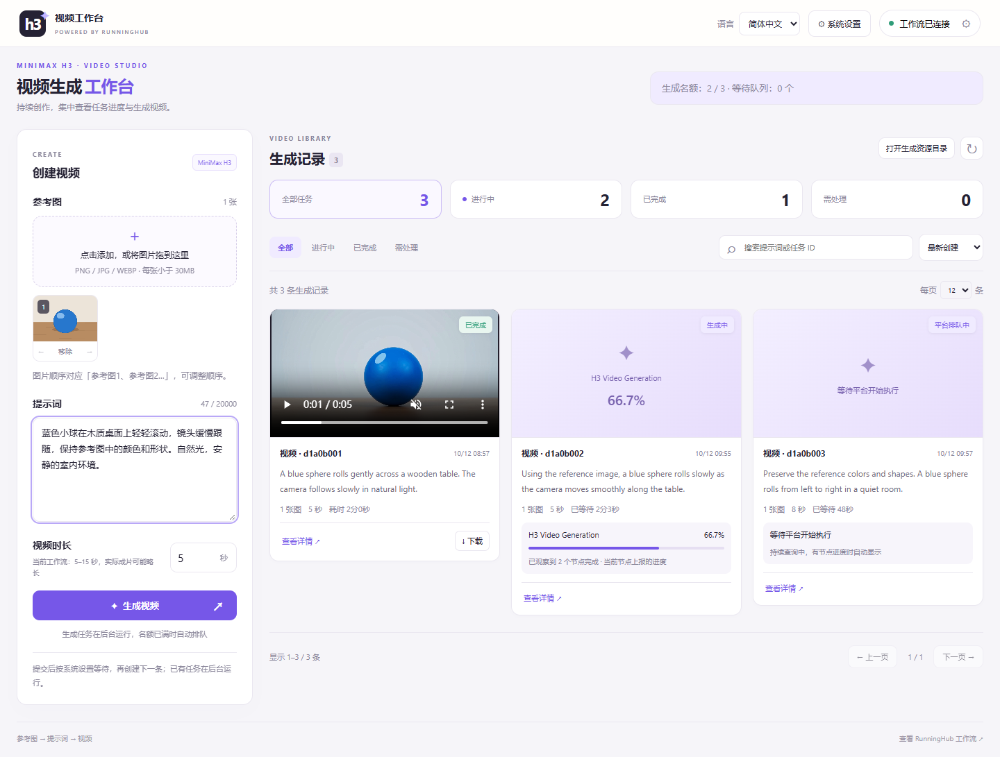
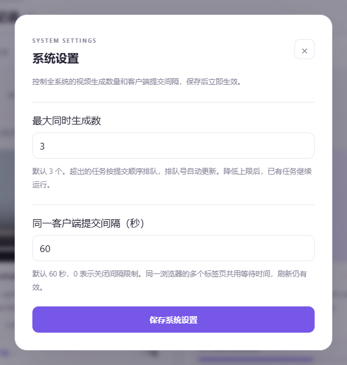

# H3 视频工作台

[English](README.md) | **简体中文**

把参考图和创意变成视频，在一个页面里完成创作与管理。

这是一个基于 RunningHub 的 MiniMax H3 视频生成工作台。在浏览器中添加参考图、描述想要的画面、设置时长，就能提交生成任务，查看进度，并集中播放和下载成片。工作台在本机运行，适合以电脑为主的日常视频创作。



## 可以做什么

- **多图创作**：点击选择或拖入参考图，调整图片顺序，再用提示词描述主体、动作、镜头和声音。
- **剧本与分镜**：输入创意生成可编辑剧本，选择目标模型格式和视觉风格，生成多个文字分镜；每镜 Prompt 可直接填入视频创作表单。
- **持续生成**：提交后在后台处理，生成名额已满时自动排队；关闭网页后，只要本地服务仍在运行，任务就会继续。
- **查看进度**：实时了解排队、生成和保存状态，节点提供进度时显示百分比。
- **管理成片**：集中播放、下载视频，按状态筛选、搜索历史记录，也能直接打开本地视频目录。
- **控制节奏**：调整同时生成的任务数量和提交间隔，按自己的使用习惯安排创作。
- **切换语言**：右上角可选择 English 或简体中文。首次打开默认英文，浏览器会记住你的选择。

## 界面预览

上图展示了创建视频、查看进度与管理成片的工作区。右上角的「系统设置」可以调整生成数量和提交间隔。



截图使用演示任务展示当前界面。

## 开始使用

需要 Windows、Python 3.11 或更新版本，以及自己的 RunningHub API Key。

1. 下载项目，在项目目录打开 PowerShell，运行：

   ```powershell
   .\start.ps1
   ```

2. 首次运行会自动准备环境并创建 `.env` 文件。在 `.env` 中填写 `RUNNINGHUB_API_KEY`，再运行一次启动脚本，服务会自动重启并读取新配置。
3. 在浏览器打开 [视频工作台](http://127.0.0.1:8765)，首次打开为英文，可在右上角选择「简体中文」。点击「工作流待配置」，读取工作流并确认图片、提示词和时长的对应设置。
4. 添加参考图，填写提示词和时长，点击「生成视频」。在右侧查看任务进度，完成后即可播放或下载。

再次运行 `./start.ps1` 会重启该端口上由当前项目启动的服务；端口被其他程序占用时会提示并退出。指定端口可运行 `./start.ps1 -Port 8766`。

默认使用 [RunningHub H3 工作流](https://www.runninghub.cn/workflow/2108942308824670209)。该工作流支持 1–9 张参考图；图片和时长范围以实际工作流配置为准。视频生成通过你的 RunningHub 账户执行，费用按平台规则结算。

## 从创意到分镜

在 `.env` 中单独配置支持 OpenAI `chat/completions` 协议的文本服务，保存后重启：

```dotenv
LLM_BASE_URL=https://api.openai.com/v1
LLM_API_KEY=填写自己的文本模型密钥
LLM_MODEL=填写服务商支持的模型名
LLM_TIMEOUT_SECONDS=120
```

`LLM_BASE_URL` 是 API 根地址，系统会追加 `/chat/completions`。文本服务的 Key 与 RunningHub Key 独立，可使用其他提供兼容接口的服务。

点击创建视频栏中的「剧本与分镜」，输入创意并生成剧本；编辑剧本后，设置分镜数量、每镜时长、目标模型格式和可选视觉风格，生成文字分镜。支持 H3、通用或自定义目标模型及格式要求。点击某镜的「用于视频生成」，会将当前编辑后的 Prompt 填入视频提示词框；添加或确认参考图后即可生成该镜视频。

剧本和每镜内容随模型输出实时显示，文本服务需支持流式输出。分镜卡片使用交替浅色底、独立标题栏和明显间距。生成期间为只读预览，最终校验通过后可编辑和使用；中途失败或断流会恢复原草稿。

目标模型选项控制 Prompt 的写法，实际视频模型由连接的 RunningHub 工作流决定。每个分镜对应一段独立视频。若分镜时长超出当前工作流范围，系统会提示调整，并保留视频表单的时长。创作草稿自动保存在当前浏览器，刷新后可继续编辑。

## 文件保存在哪里

参考图和生成视频保留在本机，默认位于项目的 `data` 目录。点击「打开生成资源目录」可以找到成片，方便整理和备份。

## 更多说明

需要更换工作流、了解详细配置或进行开发，请查看 [技术与配置说明](docs/technical-guide.md)。
